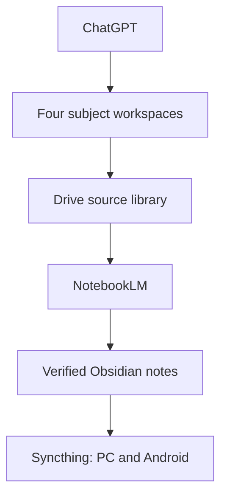

# Study Notes

A four-subject study-memory workspace built around the current textbook PDFs.

- ChatGPT is the normal input and orchestration surface.
- Google Drive is the intended private source-file library used by NotebookLM.
- NotebookLM processes one subject at a time and returns cited candidate notes.
- Obsidian is the durable memory layer.
- Syncthing and Syncthing-Fork replicate only the Obsidian vault between PC and Android.



## Subjects

| Subject | Canonical source | NotebookLM workspace | Obsidian entry point |
| --- | --- | --- | --- |
| Networking Fundamentals | `SRC-0001 - Network Fundamentals - CCNA Exploration Companion Guide.pdf` | `Academic Source Library/networking-fundamentals/` | `Obsidian Vault/Topics/networking-fundamentals/00 Topic Map.md` |
| Computing Research Methods | `SRC-0001 - Researching Information Systems and Computing.pdf` | `Academic Source Library/computing-research-methods/` | `Obsidian Vault/Topics/computing-research-methods/00 Topic Map.md` |
| Systems Analysis and Design | `SRC-0001 - Systems Analysis and Design in a Changing World.pdf` | `Academic Source Library/systems-analysis-and-design/` | `Obsidian Vault/Topics/systems-analysis-and-design/00 Topic Map.md` |
| C++ Programming | `SRC-0001 - Starting Out with C++ - Ninth Global Edition.pdf` | `Academic Source Library/cpp-programming/` | `Obsidian Vault/Topics/cpp-programming/00 Topic Map.md` |

The cross-topic entry point is `Obsidian Vault/Topics/cross-topic-index/00 Topic Map.md`.

## Start here

1. Open `Obsidian Vault/` as an Obsidian vault.
2. Read `Obsidian Vault/00 Study Home.md`.
3. Follow `docs/SYNCTHING_SETUP.md` to sync the vault.
4. Mirror each `Academic Source Library/<topic>/` folder to a private Google Drive folder.
5. Create four NotebookLM notebooks and use each topic's `01 NotebookLM Processing Prompt.md`.
6. Paste NotebookLM's final handoff into ChatGPT for verification and conversion into atomic notes.

## Repository checks

Run:

```bash
python3 scripts/rebuild_notebooklm_manifests.py
python3 scripts/validate_study_structure.py
```

The PDFs are copyrighted textbooks. Their presence in this repository does not establish redistribution or third-party-upload rights. The evidence ledgers therefore keep `rights: unknown` and `external_upload: ask` until the user explicitly authorizes the relevant service upload.
