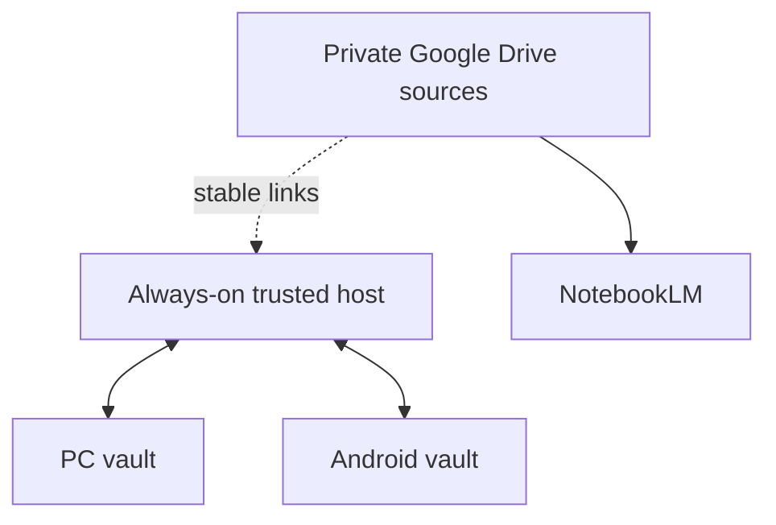

# Syncthing setup for PC and Android

Use Syncthing as the only bidirectional sync engine for `Obsidian Vault/`. Google Drive stores source binaries separately and must not also synchronize the live vault.

## Recommended topology

The always-on host may be the main PC initially. A NAS or home-lab server can replace it later without changing the vault format.

## Setup

1. Install Syncthing on the host and PC.
2. Install the maintained Syncthing-Fork Android client from F-Droid or its verified project release.
3. Share only `Obsidian Vault/` as `Send & Receive`.
4. On Android, map it to a normal local folder such as `Internal storage/Documents/Obsidian/Study-Notes` and open that folder in Obsidian.
5. Enable staggered file versioning on the always-on host. Keep a separate backup because sync history is not a backup.
6. Let the first sync finish before opening the vault on another device.
7. Exempt Syncthing-Fork from Android battery optimization only as needed for reliable background sync; retain your preferred Wi-Fi/mobile-data restrictions.

## Required test before migration

Use a disposable note and verify:

- host to PC;
- PC to Android;
- Android to host;
- deletion propagation;
- conflict-copy creation from simultaneous edits;
- restore from host version history.

## Conflict policy

- Avoid editing the same note simultaneously on PC and Android.
- Preserve conflict copies until they are compared.
- Keep filename casing consistent across Windows, Linux, and Android.
- Sync the notes and chosen Obsidian configuration, but ignore device-specific workspaces and cache files using `Obsidian Vault/.stignore`.
- Never enable Obsidian Sync, FolderSync, LiveSync, or Remotely Save for this same live vault while Syncthing is active.
